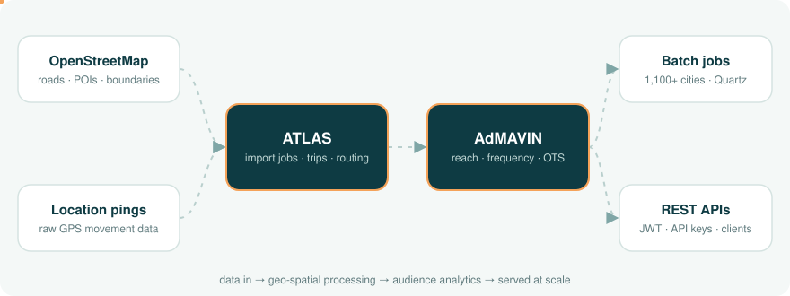

  

  

  &nbsp;
  &nbsp;
  &nbsp;
  

---

## 💼 Current work

**Software Engineer @ Mandark Technologies (AdMAVIN)** · Jul 2023 – Present

- **Audience analytics** — reach, frequency and OTS calculations with age, gender and income splits.
- **Batch processing** — Quartz jobs that pre-compute metrics across **1,100+ cities**.
- **API platform** — campaign and bulk-media REST APIs, API-key subscriptions secured with JWT and role-based access.
- **Geo-spatial (ATLAS)** — OpenStreetMap imports, trip and road-visit pipelines, GraphHopper routing.
- **Production** — server deployments, debugging and live support, including the 2024 Lok Sabha election campaigns.

## 📊 By the numbers

<table>
  <tr>
    <td align="center" width="33%"><h2>1,100+</h2>cities analysed by my batch jobs</td>
    <td align="center" width="33%"><h2>3.5+ yrs</h2>shipping Java to production</td>
    <td align="center" width="33%"><h2>2024</h2>national election campaign kept live</td>
  </tr>
</table>

## 🧭 What I work on

  

## 🛠️ Tech stack

**Languages & Frontend**

  
  
  
  
  
  
  

**Spring & Java**

  
  
  
  
  
  
  
  
  
  
  

**APIs & Security**

  
  
  
  
  

**Databases**

  
  
  
  

**Data Processing**

  
  
  
  
  

**Geo-spatial**

  
  
  

**Cloud & Deployment**

  
  
  
  
  
  

**Tools**

  
  
  
  
  
  
  
  
  

## 🚀 Featured projects

| Project | Description | Stack |
| --- | --- | --- |
| [Online Cab Booking API](https://github.com/Rupesh8844/Online_Cab_Booking_System) | Customer, driver, admin and trip-booking modules with session-token auth | Spring Boot, JPA, MySQL, Swagger |
| [Online Shopping API](https://github.com/Rupesh8844/REST-API-Service-for-E-Commerce-Website) | E-commerce backend built with a team of six at Masai School | Spring Boot, Hibernate, MySQL |
| [AcmeFresh API](https://github.com/Rupesh8844/AcmeFresh-Project) | REST backend for a hydroponic farming company | Spring Boot, JPA, MySQL |
| [Customer Auth API](https://github.com/Rupesh8844/Customer_Register_Login_Logout) | Registration, login and logout with session handling | Spring Boot |

> Most of my professional work (AdMAVIN, ATLAS, client projects) lives in private company repositories.

## 📫 Let's connect

  &nbsp;&nbsp;
  &nbsp;&nbsp;
  &nbsp;&nbsp;
  &nbsp;&nbsp;
  &nbsp;&nbsp;
  

<b>Open to Java backend roles</b> · let's build something reliable.

